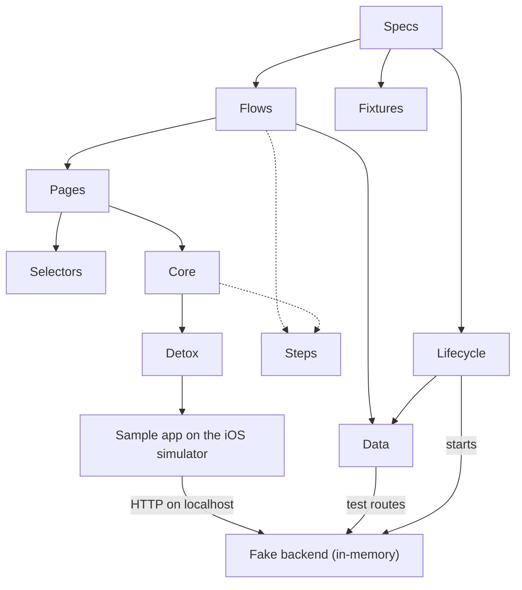

# Detox E2E architecture for React Native

A layered end-to-end test architecture for React Native, written in strict TypeScript on
[Detox](https://wix.github.io/Detox/) and [Jest](https://jestjs.io/). Fork it as a starting point for your own
suite: the layers (Specs, Flows, Pages, Selectors, Core, Data, Lifecycle) are generic, and only the pages, flows and
fixtures are specific to the sample app.

It runs against a small sample app and an in-memory fake backend that are both in this repository, so you can
clone it and see a green run before changing anything. [Using this in your own app](#using-this-in-your-own-app)
shows what to keep and what to replace.

## What is in here

| Path            | What it is                                                                                                            |
| --------------- | --------------------------------------------------------------------------------------------------------------------- |
| `e2e/`          | The suite: Specs, Flows, Pages, Selectors, Fixtures, Lifecycle, Data, Core                                            |
| `example-app/`  | Bare React Native 0.84 app (iOS): welcome, sign in, create account with an emailed code, home, profile, notifications |
| `fake-backend/` | Dependency-free Node HTTP server with an in-memory store, plus test-only routes the suite uses                        |
| `.detoxrc.js`   | Detox apps, simulator and configurations                                                                              |

## Architecture

Each layer only talks to the ones below it. A spec reads like a description of what a user does, and a changed
testID, timeout or backend touches one file.



Solid arrows are dependencies; dotted arrows mean "reports to the step log".

- **Specs** call `prepareSuite` for their setup, run flows, and assert on both the screen and the stored data.
- **Flows** are named user journeys built from page actions (`signInAs(person)`, `changeNotifications({...})`).
  `defineFlow` gives each one a name in the step log, built from its arguments.
- **Pages** describe one screen in the app's words (`signUpPage.enterDetails`, `tabBar.open('profile')`). The
  `ScreenObject` base class knows how to wait until a screen is open, and the back button.
- **Selectors** hold every testID. Pages never hard-code one.
- **Core** is the only layer that calls Detox. `Control` wraps one view by testID: `tap` waits until the view is
  visible and enabled, `fill` types without logging the value, and `switchTo` flips a switch only when needed.
  `acknowledgeDialog` checks the app's dialog and closes it.
- **Lifecycle** registers the Jest hooks. The backend starts once per file. Before each test the data is reset
  and reseeded and the app starts in a new process; the first launch also reinstalls it.
- **Data** (`testApi`) is the suite's only way into backend data. `createAccount` reads the emailed code through
  it, and the notifications spec checks what the backend actually saved. To run against another backend,
  reimplement its four functions.
- **Core/Steps** wraps every action in a step. Parent steps print a header, every step prints its result and
  duration, and a failing step adds the path that led to it to the error message:

```text
› Sign in as avery@example.com
  › Welcome screen is open
    ✔ see welcome.screen · 640 ms
  ✔ Welcome screen is open · 641 ms
  ✔ tap welcome.sign-in-button · 212 ms
  ...
  ✘ tap sign-in.submit-button · 12034 ms
✘ Sign in as avery@example.com · 13180 ms

Error: [Sign in as avery@example.com > tap sign-in.submit-button] sign-in.submit-button stayed disabled for 12000 ms
```

(Shortened, and the timings are illustrative.)

## The specs

- `ReturningUser.spec.ts`: a seeded user signs in and is greeted by name, a wrong password shows an error, the
  user changes notification settings (checked in the backend), and signs out from Profile.
- `NewAccount.spec.ts`: a new person creates an account with the emailed code, an invalid email is flagged before
  any code is sent, and an email that already has an account is refused.

## Requirements

- Node.js 22.11 or later and npm
- For the device run: macOS with Xcode and an iOS simulator runtime, CocoaPods, and
  [applesimutils](https://github.com/wix/AppleSimulatorUtils) (`brew tap wix/brew && brew install applesimutils`)

Versions: Detox 20.51, Jest 30, TypeScript 6.0, React Native 0.84.1 (inside the range Detox 20 officially
supports, 0.77 to 0.84).

## Run the checks (any OS)

```sh
npm ci
npm ci --prefix example-app
npm run lint          # ESLint (typescript-eslint strict, type-checked) + Prettier
npm run typecheck     # suite, fake backend and sample app
npm run test:unit     # fake backend over real HTTP, no simulator
```

## Run the Detox suite (macOS)

```sh
npm ci
npm run app:install     # example-app dependencies + pod install
npm run e2e:build:ios   # Release build of the sample app for the simulator
npm run e2e:test:ios    # boots the simulator and runs e2e/Specs (each spec file starts the fake backend itself)
```

The suite uses an "iPhone 17" simulator by default. Pick another model with
`DETOX_DEVICE_TYPE="iPhone 16" npm run e2e:test:ios`. The spec files start the fake backend on port 4545, so
nothing else should be listening there.

## Use the sample app by hand

```sh
npm run backend                  # terminal 1: fake backend on port 4545
npm --prefix example-app start   # terminal 2: Metro
npm --prefix example-app run ios # terminal 3: build and open the app in the simulator
```

A hand-started backend begins empty, so start with Create account. No email is sent. When you tap Next on the details step, the backend terminal
prints `Verification code for <email>: <code>`. You can also fetch the latest code from the test route:

```sh
curl 'http://localhost:4545/__test__/verification-code?email=you@example.com'
```

## Using this in your own app

Keep the generic parts, replace the sample-app parts.

**Keep (generic):** `e2e/Core/` (`Control`, `Steps`, `Dialog`), `e2e/Pages/ScreenObject.ts`,
`e2e/Flows/DefineFlow.ts`, `e2e/Lifecycle/Harness.ts`, `e2e/Config.ts`, `e2e/jest.config.js`, and the tooling
configs (`.detoxrc.js`, `tsconfig.json`, ESLint and Prettier).

**Replace (sample-app specific):** `e2e/Selectors/TestIds.ts`, `e2e/Pages/*`, `e2e/Flows/*`, `e2e/Fixtures/*`,
`e2e/Model.ts`, `e2e/Specs/*`. `Core/Dialog.ts` encodes the sample app's dialog; adapt or delete it.

1. **Install the tooling.** Copy the `devDependencies` you need from [package.json](package.json): `detox`, `jest`,
   `ts-jest`, `@jest/globals`, `typescript`, and `tsx` if you keep the fake backend.
2. **Point Detox at your app.** In `.detoxrc.js`, change `binaryPath` and the `xcodebuild` workspace and scheme
   (`SampleApp`) to yours.
3. **Add testIDs to your app** and list them in `Selectors/TestIds.ts`. The convention here is `screen.element`.
4. **Write the first screen.** Add a page extending `ScreenObject`, with a `label` and the `rootId` that proves the
   screen is open, then actions built from `Control`:

   ```ts
   class SettingsPage extends ScreenObject {
     protected readonly label = 'Settings screen';
     protected readonly rootId = ids.settings.screen;

     public async toggleDarkMode(on: boolean): Promise<void> {
       await Control.id(ids.settings.darkMode).switchTo(on);
     }
   }

   export const settingsPage = new SettingsPage();
   ```

5. **Compose flows and specs.** A flow is a named journey (`defineFlow`); a spec calls `prepareSuite(seed)` and then
   reads like a description of the user:

   ```ts
   describe('Settings', () => {
     prepareSuite(seededPeople);

     it('turns dark mode on', async () => {
       await signInAs(people.avery);
       await tabBar.open('settings');
       await settingsPage.waitUntilOpen();
       await settingsPage.toggleDarkMode(true);
     });
   });
   ```

6. **Decide where test data comes from.** `prepareSuite` starts the fake backend in the Jest process and resets
   and seeds it before every test. For a real or staging backend, reimplement the four functions in
   `Data/TestApi.ts` (`reset`, `seed`, `latestCode`, `account`) and remove the backend start from `Harness.ts`.

### Android

The sample app ships no Android project, and `.detoxrc.js` has iOS configurations only. The suite code (Core, Pages,
Flows, Specs) is written against Detox's cross-platform API, but it has only been run on iOS. To add Android, add an
emulator device and an APK app to `.detoxrc.js` as described in the
[Detox project setup guide](https://wix.github.io/Detox/docs/introduction/project-setup), then add a configuration
that pairs them. Expect to adjust `ScreenObject.goBack` (the sample app has its own header back button) and the
keyboard handling in pages (`closeKeyboard`) for your app.

## Troubleshooting

- **The suite cannot find the app.** `e2e:build:ios` must have run for the same configuration. The `release`
  configuration needs no Metro; the `debug` configuration does (`npm --prefix example-app start`).
- **Wrong or missing simulator.** The default is "iPhone 17". Set `DETOX_DEVICE_TYPE` to a model you have installed
  (`xcrun simctl list devicetypes`).
- **`applesimutils` not found.** `brew tap wix/brew && brew install applesimutils`.
- **Port 4545 is in use.** The spec files start the fake backend there, so stop any hand-started backend. To use
  another port, change `FAKE_BACKEND_PORT` and the `API_URL` in `example-app/src/api.ts` together.
- **Slow machine or CI, waits time out.** Raise `E2E_WAIT_MS` (default 12000).
- **A test failed and you want to see why.** The step log names the failing step and the path that led to it, and
  Detox saves a screenshot and device log of failing tests under `artifacts/`.

## CI

`.github/workflows/ci.yml` runs lint, format check, typecheck and the backend unit tests on every push and pull
request. The iOS build and Detox run is a separate macOS job you start manually from the Actions tab
(`workflow_dispatch` with `detox` checked), because macOS runner minutes are expensive.

## Conventions

- testIDs are `screen.element` (`sign-in.email-input`, `dialog.primary-button`).
- Folders and files in `e2e/` are PascalCase, which ESLint enforces.
- Async helpers always `return await`, so the failing step shows up in stack traces.

## License

[MIT](LICENSE)
